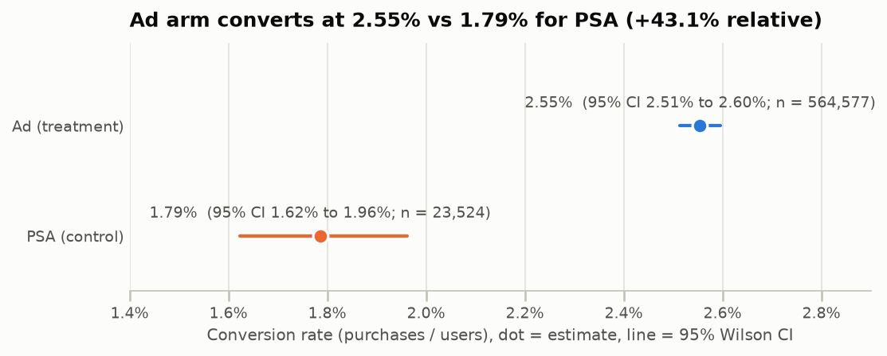
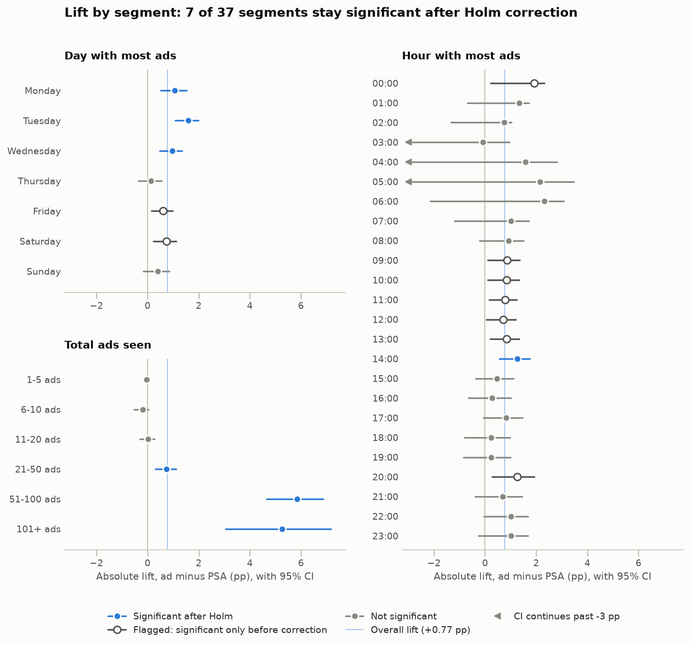
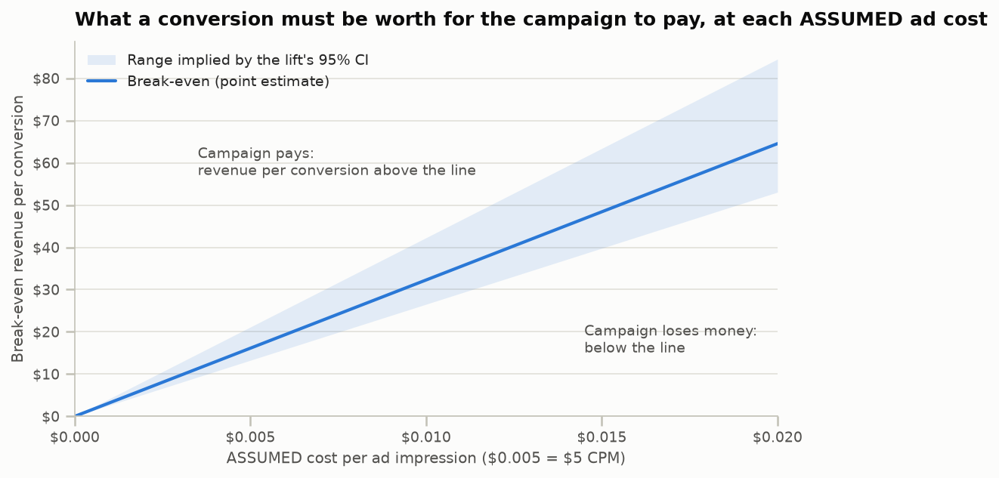

# Did the ad campaign lift conversion enough to justify spend?

This project analyses an A/B test of an online ad campaign. 588,101 users were randomly assigned to see either an **ad** (treatment) or a **public service announcement (PSA)** in the same slot (control). The ad lifted purchase conversion from 1.79% to 2.55% (+43.1% relative, p = 1.7e-13). Whether that is enough to pay for the impressions depends on ad cost, so the analysis ends with a break-even table and a targeting recommendation.



## Problem

The marketing team has to decide whether to keep paying for the campaign. That breaks down into three questions:

1. Did the ad cause more purchases than the PSA control, and by how much?
2. Is that lift big enough to cover the cost of the ad impressions?
3. Is the lift concentrated in particular users or times, so that targeting is worth refining?

## Data

The data is [Marketing A/B Testing](https://www.kaggle.com/datasets/faviovaz/marketing-ab-testing) on Kaggle: the file `marketing_AB.csv`, with 588,101 rows and one row per user.

| Column | Meaning |
|---|---|
| `user id` | Unique user |
| `test group` | `ad` (saw the ad) or `psa` (saw a public service announcement in the same slot) |
| `converted` | `True` if the user bought the product |
| `total ads` | Number of ads (or PSAs) the user saw |
| `most ads day` / `most ads hour` | Day and hour on which the user saw the most ads |

The dataset has **no cost or revenue fields**, so every dollar figure below rests on clearly labelled assumptions.

**To download:** get `marketing_AB.csv` from the Kaggle page linked above (you need a free Kaggle account) and save it as `data/marketing_AB.csv`. The `data/` folder is git-ignored, so the file is never committed.

## Method

The full analysis is in [`analysis.ipynb`](analysis.ipynb):

1. **Data audit.** Checks dtypes, nulls, duplicate rows and users, and value ranges. The unnamed first column is a saved row index and is dropped.
2. **Experiment sanity check.** Runs a sample-ratio mismatch (SRM) chi-square test against the 96/4 allocation. It also checks that delivery (exposure, day and hour) is balanced across arms, using standardized mean differences and Cramér's V.
3. **Primary test.** Runs a two-proportion z-test (`statsmodels`) and reports absolute and relative lift with 95% CIs. A chi-square test confirms the result. A robustness check re-weights the PSA arm to the ad arm's day, hour and exposure mix.
4. **Power analysis.** Computes the minimum detectable effect (MDE) for the PSA arm's size at 80% power and α = 0.05.
5. **Segments.** Measures lift by most-ads day (7 segments), most-ads hour (24) and total-ads bucket (6). Each segment uses Fisher's exact test, with Holm correction across all 37. Segments that are significant only before correction are flagged.
6. **Business translation.** Converts the lift into incremental purchases per 1,000 users exposed, and builds a break-even table over **assumed** ad costs and revenue per conversion.
7. **Recommendation**, with caveats.

## Key results

Every number in this README is computed in the notebook.

| Metric | Result |
|---|---|
| Users (ad / PSA) | 564,577 / 23,524 |
| Conversion rate (ad / PSA) | 2.55% / 1.79% |
| Absolute lift (95% CI) | +0.77 pp (+0.59 to +0.94 pp) |
| Relative lift (95% CI) | +43.1% (+30.0% to +57.5%) |
| Two-proportion z-test | z = 7.37, p = 1.7e-13 |
| Chi-square confirmation | χ² = 54.32, p = 1.7e-13 |
| Sample-ratio check vs 96/4 plan | p = 0.9998 (no mismatch) |
| MDE at 80% power, α = 0.05 | +0.26 pp (+14.3% relative) |
| Incremental purchases per 1,000 users exposed | 7.69 (5.87 to 9.36) |
| Ad impressions per 1,000 users exposed | 24,823 |
| Break-even revenue per conversion | $3.23 per $1 CPM (conservative $4.23) |
| Segments significant after Holm | 7 of 37 (9 more flagged: significant only before correction) |

**Why the 96/4 split is not a problem.** The imbalance is deliberate, and the observed split matches the 96/4 plan (SRM p = 0.9998). Unequal arm sizes cost precision, not validity. Even so, the 23,524-user PSA arm can detect lifts down to +0.26 pp, and the observed lift is 3.0x that. The arms differ slightly in delivery timing, but re-weighting for it moves the lift by at most 0.03 pp.

### Segments



- **Exposure.** The lift sits in users who saw more than 20 ads: +0.74 pp at 21-50 ads, +5.86 pp at 51-100 and +5.25 pp at 101+. Users with 20 or fewer ads, 66.0% of the ad arm, show no detectable lift. *However*, PSA users also convert far more as exposure rises (0.28% at 1-5 ads, 11.88% at 101+), so exposure mostly measures user intent rather than an ad "dose".
- **Day and hour.** Monday, Tuesday, Wednesday and 14:00 stay significant after Holm correction. Friday, Saturday and seven hours are **flagged** because they are significant only before correction. Hour cells are underpowered: a median hour segment needs a +75% lift to be detectable.

### Business translation, built on ASSUMPTIONS

- The ad generates **7.69 incremental purchases per 1,000 users exposed** (95% CI 5.87 to 9.36), from 24,823 impressions.
- Only 30.1% of the ad arm's purchases were incremental. Last-click attribution would have credited all of them to the ad.
- **Break-even revenue per conversion is about $3.23 for every $1 of CPM**, or $4.23 at the conservative end of the CI. At an *assumed* $5 CPM, a conversion must be worth at least $16.13.

| ASSUMED cost per ad | Same as CPM | Break-even revenue per conversion | Conservative (lift at CI low) |
|---|---|---|---|
| $0.0010 | $1.00 | $3.23 | $4.23 |
| $0.0025 | $2.50 | $8.07 | $10.57 |
| $0.0050 | $5.00 | $16.13 | $21.13 |
| $0.0100 | $10.00 | $32.27 | $42.26 |
| $0.0200 | $20.00 | $64.54 | $84.53 |

> Cost per ad and revenue per conversion are **ASSUMPTIONS**, not data. Replace them with the real CPM and the real margin per conversion. The notebook also has a full net-profit grid.



## Recommendation: ship, with refined targeting

1. **Ship.** The lift is real: +0.77 pp with p = 1.7e-13, 3.0x the MDE, and it holds up when the PSA arm is re-weighted. The campaign pays whenever a conversion is worth more than about $3.23 per $1 of CPM, or $4.23 to be conservative. Check that against the real CPM and margin first. If the margin per conversion is below the conservative break-even, don't ship.
2. **Refine targeting before scaling spend.** Use randomized follow-up tests rather than acting on the observational cuts:
   - **Test a frequency cap** of about 100 impressions. The 101+ bucket absorbs 29.0% of impressions but yields only 0.29 incremental purchases per 1,000 impressions, against 0.84 for the 51-100 bucket.
   - **Test moving spend away from light users.** Users with 20 or fewer ads take 20.9% of impressions with no measurable lift.
   - **Don't daypart yet.** Most day and hour effects fail correction.
3. **Keep a holdout** so incrementality is measured continuously. A holdout of this size detects relative lifts of about 14.3%.

**Caveats:**

- **Exposure-count confounding.** Exposure tracks user intent, so the exposure-bucket lifts are not a dose-response curve.
- **Observational segment cuts.** Day, hour and exposure are all recorded after assignment. Buyers who keep browsing also pile up extra impressions, which is reverse causation.
- **Inferred allocation.** The 96/4 plan is inferred from the data rather than documented.
- **No cost or margin data.** Every break-even figure depends on the assumptions above.
- **Limited scope.** There is one test window, the only outcome is purchase, and the data has no timestamps.

## How to run

You need Python 3.12 or newer.

```bash
git clone https://github.com/NidheeshK7/ab-test-ad-effectiveness.git
cd ab-test-ad-effectiveness
python3 -m venv venv
source venv/bin/activate          # Windows: venv\Scripts\activate
pip install -r requirements.txt
# download marketing_AB.csv from Kaggle into data/ (see "Data" above)
jupyter notebook analysis.ipynb   # then Kernel > Restart & Run All
```

To re-run the notebook headlessly in a fresh kernel, which also regenerates the charts in `figures/`:

```bash
jupyter nbconvert --to notebook --execute --inplace analysis.ipynb
```

## Repository layout

```
├── analysis.ipynb     the analysis, executed with outputs
├── figures/           charts written by the notebook
├── data/              marketing_AB.csv goes here (git-ignored)
├── requirements.txt   pinned dependencies
└── README.md
```
